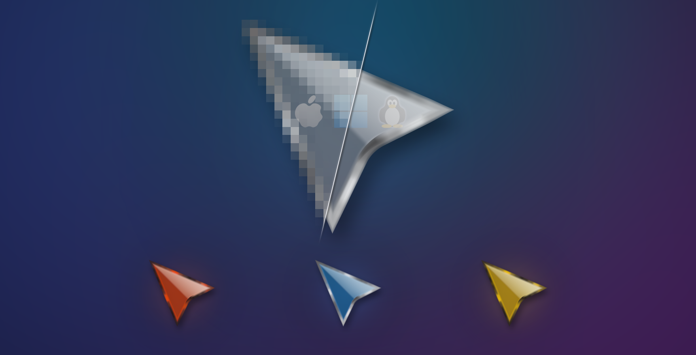
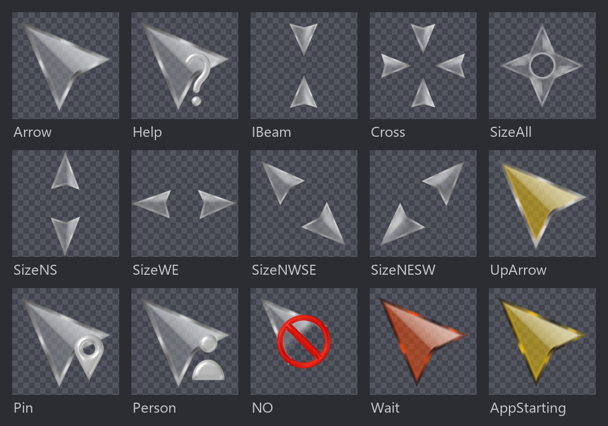

<div align="center">

# Chrome Glass Remastered

**The 2006 Chrome Glass cursors, redrawn for today's screens.**

[](README.ru.md)
[](https://github.com/mikedigriz/Chrome-Glass-Remastered-cursors/releases/latest)
[](LICENSE)

[](https://github.com/mikedigriz/Chrome-Glass-Remastered-cursors/releases/latest)

**Windows 10/11 · Linux · macOS 14+**



</div>

In 2006 RPGFX released the [Chrome Glass](https://www.wincustomize.com/explore/cursorfx/1875) cursor set. Back then cursors were drawn as 32 by 32 pixel pictures, and today's screens simply stretch them, so they come out blurry.

The remaster brings the sharpness back. The cursor is drawn separately for every size from 32 to 512 pixels, so it stays crisp on a 4K screen and with a big pointer. The shapes, colours and animation are the same as in 2006.

## Animation

Left to right: **AppStarting** - working in the background, **Hand** - a link, **Handwriting** - pen input, **NO** - not allowed, **Wait** - busy.


## Installation

| Your system | File | How it goes on |
|---|---|---|
| Windows 10/11 | [`ChromeGlassRemastered-windows.zip`](https://github.com/mikedigriz/Chrome-Glass-Remastered-cursors/releases/latest/download/ChromeGlassRemastered-windows.zip) | right-click `Install.inf`, choose **Install** |
| Linux | `.deb`, or [`ChromeGlassRemastered-linux.tar.xz`](https://github.com/mikedigriz/Chrome-Glass-Remastered-cursors/releases/latest/download/ChromeGlassRemastered-linux.tar.xz) | install the package, or unpack into `~/.icons` |
| macOS 14+ | [`ChromeGlassRemastered.cape`](https://github.com/mikedigriz/Chrome-Glass-Remastered-cursors/releases/latest/download/ChromeGlassRemastered.cape) | open it with [Mousecape](https://github.com/sdmj76/Mousecape-swiftUI) |

<details open>
<summary><b>🪟 &nbsp;Windows 10 / 11</b></summary>

1. Unpack `ChromeGlassRemastered-windows.zip`.
2. Right-click `Install.inf` and choose **Install**. On Windows 11, open **Show more options** first if the command is hidden.
3. Go to **Settings → Bluetooth & devices → Mouse → Additional mouse settings → Pointers**, pick **Chrome Glass Remastered** under *Scheme*, click **Apply**.
4. Tip: **Settings → Accessibility → Mouse pointer and touch**, and make the pointer bigger. The bigger the pointer, the more detail you see.

To update: install the new `Install.inf` over the old one as in step 2, then pick the scheme again on the **Pointers** tab and click **Apply**.

To remove it: same **Pointers** tab, select the scheme, click **Delete**, then switch back to **Windows Default** and click **Apply**. The files stay in `%WINDIR%` until you delete them - see [full removal](docs/DETAILS.md#windows).

</details>

<details>
<summary><b>🐧 &nbsp;Linux</b></summary>

| Distro | Install |
|---|---|
| Debian / Ubuntu / Mint | `sudo apt install ./chrome-glass-remastered-cursors_*_all.deb` |
| Arch / Manjaro | download the release `PKGBUILD`, run `makepkg -si` in its directory |
| Any, no root | `mkdir -p "$HOME/.icons" && tar -xf ChromeGlassRemastered-linux.tar.xz -C "$HOME/.icons"` |

Then pick **Chrome Glass Remastered** in GNOME Tweaks, or **System Settings → Colors & Themes → Cursors** on KDE Plasma 6 (**Appearance → Cursors** on Plasma 5). From a terminal:

```sh
gsettings set org.gnome.desktop.interface cursor-theme "Chrome Glass Remastered"  # GNOME
plasma-apply-cursortheme "Chrome Glass Remastered"                                # KDE Plasma
```

To make the pointer bigger: `gsettings set org.gnome.desktop.interface cursor-size 48` on GNOME; on KDE Plasma, the size list on the same **Cursors** page.

On Hyprland the theme also works as a hyprcursor theme, which fits any size by itself. Add to `hyprland.conf`:

```ini
env = HYPRCURSOR_THEME,Chrome Glass Remastered
env = HYPRCURSOR_SIZE,48
```

To remove it: `sudo apt remove chrome-glass-remastered-cursors`, `sudo pacman -R chrome-glass-remastered-cursors`, or `rm -rf ~/.icons/"Chrome Glass Remastered"` for the manual install.

</details>

<details>
<summary><b>🍎 &nbsp;macOS 14+</b></summary>

1. Install [Mousecape SwiftUI](https://github.com/sdmj76/Mousecape-swiftUI/releases). It needs macOS Sonoma 14 or later and runs on Intel and Apple Silicon.
2. Download `ChromeGlassRemastered.cape` from the latest release.
3. Double-click the cape, or import it in Mousecape, then select it and apply.

Not yet tried on a real Mac. 36 system cursors get replaced: Arrow, IBeam, Move, Wait, Busy, Crosshair and Cell, the pointing, open and closed hands, Forbidden, Help, every resize direction, and Copy, Alias, Link and the context menu with the blue arrow. The rest stay stock.

To put the system cursors back: **File → Reset System Cursor**, or <kbd>⌘</kbd>+<kbd>R</kbd>.

</details>

<details>
<summary><b>What's new since 2006</b></summary>

- **Sharpness.** Every size up to 512 pixels is drawn on its own, not stretched from 32.
- **A soft ribbon at the foot of the arrow.** The bend at the notch used to be a handful of stepped pixels. Now it is a smooth ribbon that curls round the notch and fades out.
- **A glass edge.** The rim is see-through like a glass blade and runs evenly all the way round. A silver glint follows it.
- **The points.** Clean, no jagged bits, and the fold down the middle is soft.
- **A question mark made of glass.** Help's "?" is now a glass rod with reflections, like the cursor itself.
- **Two new cursors.** Pin and Person, for picking a place and a person in Windows 10/11. The 2006 set had neither; they are drawn in the same style.
- **Not just Windows.** The set works on Linux, Hyprland included, and on macOS.

</details>

## The whole set

<div align="center">



</div>

Each cursor is labelled with its system name. For example, IBeam shows over text, Cross when you need to select something precisely, SizeAll when a window or object can be moved, and UpArrow for the alternate select.

## Not working?

- **The theme is missing from the list, or the old pointer is still there.** Log out and back in. Applications cache the cursor at startup, so restart the ones that still look wrong.
- **A pixelated icon when you middle-click to scroll, drag or zoom in a browser.** Those are the browser's own cursors, built into Chrome, Edge and other browsers. Windows has no scheme slot for them, and no cursor theme can replace them there.
- **macOS changed the pointer only in some places.** Some applications draw their own cursors, and Mousecape cannot safely replace those.

## The original

Chrome Glass was made by **RPGFX**. The set came out on 13 April 2006 on [WinCustomize](https://www.wincustomize.com/explore/cursorfx/1875) and the same day on [DeviantArt](https://www.deviantart.com/rpguere/art/ChromeGlass-31776429), where the author goes by RPGuere. This remaster is unofficial: it is made with respect for the original, and RPGFX's authorship is kept everywhere.

> **Attribution:** ten days later the same set was posted on DeviantArt by [yoyos](https://www.deviantart.com/yoyos/art/Chrome-Glass-32252748), this time under their own name. The copy got almost twice the attention:
>
> - [RPGFX original](https://www.deviantart.com/rpguere/art/ChromeGlass-31776429): 👀 161.3K · ⭐ 115
> - [yoyos copy](https://www.deviantart.com/yoyos/art/Chrome-Glass-32252748): 👀 305.8K · ⭐ 383
>
> Search engines still show the copy first, and at first I took it for the original myself.

<details>
<summary><b>The story of the original</b></summary>

In the mid-2000s Windows XP customization was at its peak, and the most striking cursors were made not in the Windows format but for Stardock's CursorXP and CursorFX, which could do translucency, smooth animation and click effects. Chrome Glass was one of them: a CursorFX pack, a companion to the same author's Vista Pro, downloaded more than 55,000 times. But it needed CursorFX installed to work.

The DeviantArt copy came as plain `.cur` and `.ani` files that Windows installs by itself. That version worked for everyone, and it was the one that spread: cursor collections took it from DeviantArt along with the credit. On Cursors-4U the [Transparent Chrome Glass Set](https://www.cursors-4u.com/cursor/transparent-chrome-glass-set) was added in June 2010 with yoyos as the creator and has been downloaded more than 24,000 times. Of the sources found, only [Gnome-look](https://www.gnome-look.org/p/999975) names RPGFX.

This remaster started from the same copy, and the copy is provably RPGFX's: every frame in `art/orig` is a frame of the original theme (its files are all dated 13 April 2006), scaled down from 37 or 50 px to fit 26 px and matching it pixel for pixel. Along the way the copy lost the 35-frame IBeam animation, where the arrow flows into the text cursor (only the last frame was kept), and the pressed states of the hand.

</details>

The cursor artwork is **not** covered by the MIT license - see [`NOTICE`](NOTICE). The build and packaging code is MIT, see [`LICENSE`](LICENSE).

## More

- **[docs/DETAILS.md](docs/DETAILS.md)** - what is inside each package, what each platform can and cannot do, full removal, checksums, the longer troubleshooting list.
- **[docs/BUILD.md](docs/BUILD.md)** - build it yourself. Python, Pillow, NumPy; a GPU is optional and only speeds the build up.
