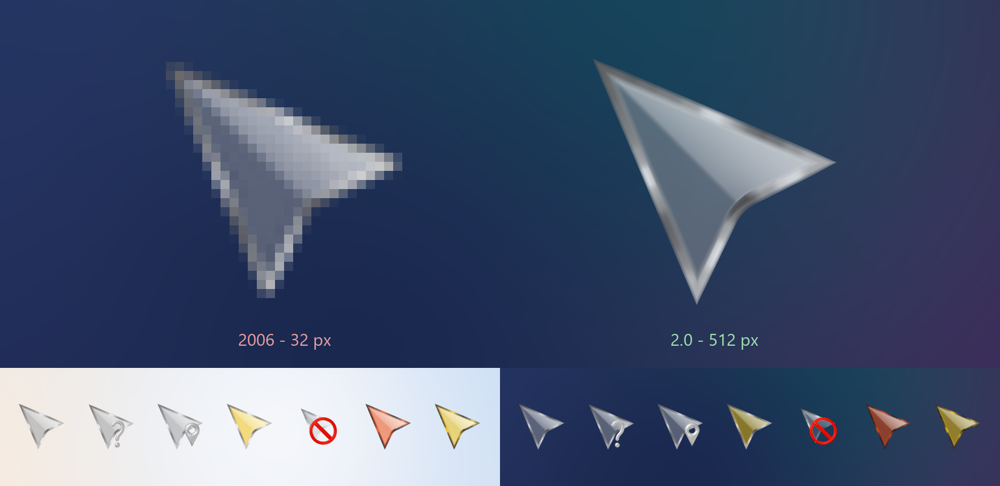
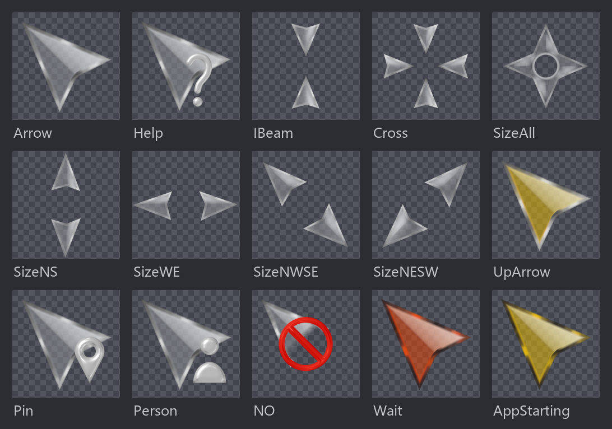
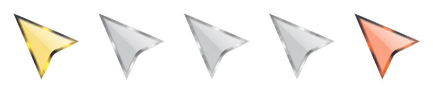

<div align="center">

# Chrome Glass Remastered

**Курсоры Chrome Glass 2006 года, перерисованные под современные экраны.**

[](README.md)
[](https://github.com/mikedigriz/Chrome-Glass-Remastered-cursors/releases/latest)
[](LICENSE)

[](https://github.com/mikedigriz/Chrome-Glass-Remastered-cursors/releases/latest)

**Windows 10/11 · Linux · macOS 14+**



</div>

В 2006 году yoyos выложил на DeviantArt набор курсоров [Chrome Glass](https://www.deviantart.com/yoyos/art/Chrome-Glass-32252748). Тогда экраны были небольшими, и курсоры рисовали картинками 32 на 32 пикселя. Сегодня экраны крупнее, курсор на них больше, и система просто растягивает старую картинку. Она получается мутной.

Здесь каждый курсор нарисован заново под каждый размер, от 32 до 512 пикселей, поэтому он остаётся чётким на любом экране и при любом увеличении. Форма, цвета и анимация - как в оригинале. Как это сделано: [docs/DETAILS.ru.md](docs/DETAILS.ru.md#как-это-собрано).

## Установка

| Система | Файл | Как ставится |
|---|---|---|
| Windows 10/11 | [`ChromeGlassRemastered-windows.zip`](https://github.com/mikedigriz/Chrome-Glass-Remastered-cursors/releases/latest/download/ChromeGlassRemastered-windows.zip) | правая кнопка по `Install.inf`, пункт **Установить** |
| Linux | `.deb` или [`ChromeGlassRemastered-linux.tar.xz`](https://github.com/mikedigriz/Chrome-Glass-Remastered-cursors/releases/latest/download/ChromeGlassRemastered-linux.tar.xz) | пакет или распаковка в `~/.icons` |
| macOS 14+ | [`ChromeGlassRemastered.cape`](https://github.com/mikedigriz/Chrome-Glass-Remastered-cursors/releases/latest/download/ChromeGlassRemastered.cape) | открыть в [Mousecape](https://github.com/sdmj76/Mousecape-swiftUI) |

<details open>
<summary><b>🪟 &nbsp;Windows 10 / 11</b></summary>

1. Распакуйте `ChromeGlassRemastered-windows.zip`.
2. Нажмите правой кнопкой по `Install.inf` и выберите **Установить**. В Windows 11 сначала откройте **Показать дополнительные параметры**, если пункт скрыт.
3. Откройте **Параметры → Bluetooth и устройства → Мышь → Дополнительные параметры мыши → Указатели**, выберите **Chrome Glass Remastered** в списке *Схема* и нажмите **Применить**.
4. Стоит сделать: **Параметры → Специальные возможности → Указатель мыши и сенсорное управление** и увеличить размер указателя. На крупном указателе детали видны лучше всего.

Как обновить: установите новый `Install.inf` поверх старого так же, как в шаге 2, затем на вкладке **Указатели** снова выберите схему и нажмите **Применить**.

Как убрать: та же вкладка **Указатели**, выберите схему, нажмите **Удалить**, затем вернитесь на **Стандартная Windows** и нажмите **Применить**. Файлы останутся в `%WINDIR%`, пока вы их не удалите сами: см. [полное удаление](docs/DETAILS.ru.md#windows).

</details>

<details>
<summary><b>🐧 &nbsp;Linux</b></summary>

| Дистрибутив | Установка |
|---|---|
| Debian / Ubuntu / Mint | `sudo apt install ./chrome-glass-remastered-cursors_*_all.deb` |
| Arch / Manjaro | скачайте `PKGBUILD` из релиза и выполните `makepkg -si` в его каталоге |
| Любой, без root | `mkdir -p "$HOME/.icons" && tar -xf ChromeGlassRemastered-linux.tar.xz -C "$HOME/.icons"` |

Дальше выберите **Chrome Glass Remastered** в GNOME Tweaks или в **Параметры системы → Цвета и темы → Курсоры** на KDE Plasma 6 (**Внешний вид → Курсоры** на Plasma 5). Из терминала:

```sh
gsettings set org.gnome.desktop.interface cursor-theme "Chrome Glass Remastered"  # GNOME
plasma-apply-cursortheme "Chrome Glass Remastered"                                # KDE Plasma
```

Чтобы сделать указатель крупнее: `gsettings set org.gnome.desktop.interface cursor-size 48` на GNOME, на KDE Plasma - список размеров на той же странице **Курсоры**.

На Hyprland тема работает и как hyprcursor, он сам подгоняет любой размер. Добавьте в `hyprland.conf`:

```ini
env = HYPRCURSOR_THEME,Chrome Glass Remastered
env = HYPRCURSOR_SIZE,48
```

Как убрать: `sudo apt remove chrome-glass-remastered-cursors`, `sudo pacman -R chrome-glass-remastered-cursors` или `rm -rf ~/.icons/"Chrome Glass Remastered"` для ручной установки.

</details>

<details>
<summary><b>🍎 &nbsp;macOS 14+</b></summary>

1. Установите [Mousecape SwiftUI](https://github.com/sdmj76/Mousecape-swiftUI/releases). Нужна macOS Sonoma 14 или новее, приложение universal, идёт на Intel и Apple Silicon.
2. Скачайте `ChromeGlassRemastered.cape` из последнего релиза.
3. Откройте cape двойным щелчком или импортируйте его в Mousecape, затем выберите и примените.

На живом Mac набор пока не проверялся. Заменяются 36 системных курсоров: Arrow, IBeam, Move, Wait, Busy, Crosshair и Cell, указывающая, открытая и сжатая рука, Forbidden, Help, все направления изменения размера, а также Copy, Alias, Link и контекстное меню голубой стрелкой. Остальные остаются системными.

Вернуть системные: **File → Reset System Cursor** или <kbd>⌘</kbd>+<kbd>R</kbd>.

</details>

## Весь набор

<div align="center">



</div>

Подписи - имена файлов. IBeam - выделение текста, Cross - точное выделение, SizeAll - перемещение, UpArrow - альтернативный выбор, AppStarting - работа в фоне, Wait - занят, NO - недоступно, Pin и Person - выбор места и человека.

## Анимация в движении

Анимированы пять указателей, слева направо: **AppStarting**, **Hand** на ссылке, **Handwriting** для пера, **NO** и **Wait**.



## Не работает?

- **Темы нет в списке или указатель остался прежним.** Выйдите из сеанса и войдите снова. Приложения запоминают курсор при запуске, так что перезапустите те, где он не сменился.
- **Пиксельный значок при прокрутке колесом, перетаскивании или лупе в браузере.** Это курсоры самого браузера, они зашиты в Chrome, Edge и другие браузеры. В схеме Windows для них нет слота, и ни одна тема курсоров их там не заменит.
- **На macOS курсор сменился не везде.** Часть приложений рисует свои курсоры, и Mousecape не может их безопасно подменить.

## Оригинал

Chrome Glass - [работа yoyos](https://www.deviantart.com/yoyos/art/Chrome-Glass-32252748). Это неофициальный ремастер, сделанный как дань уважения и сохраняющий авторство рядом с графикой.

Лицензия MIT **не распространяется** на графику курсоров, см. [`NOTICE`](NOTICE). Код сборки и упаковки - под MIT, см. [`LICENSE`](LICENSE).

## Дальше

- **[docs/DETAILS.ru.md](docs/DETAILS.ru.md)** - что внутри каждого пакета, что умеет и чего не умеет каждая платформа, полное удаление, контрольные суммы, длинный разбор проблем.
- **[docs/BUILD.ru.md](docs/BUILD.ru.md)** - собрать самому. Python, Pillow, NumPy; видеокарта необязательна и только ускоряет сборку.
