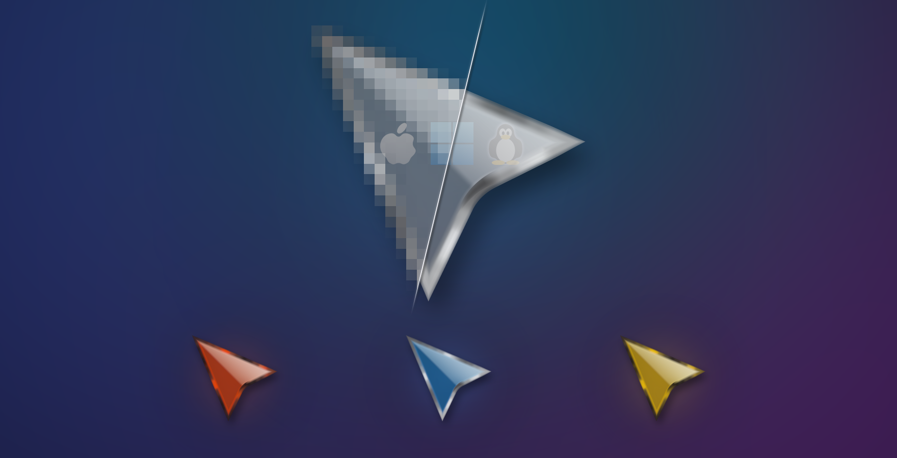
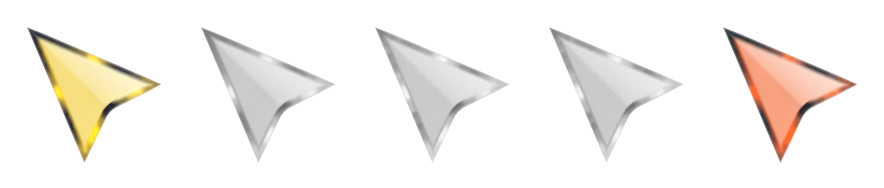
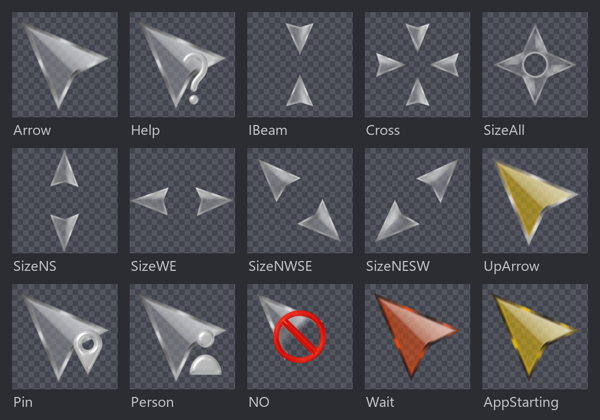

<div align="center">

# Chrome Glass Remastered

**Курсоры Chrome Glass 2006 года, перерисованные под современные экраны.**

[](README.md)
[](https://github.com/mikedigriz/Chrome-Glass-Remastered-cursors/releases/latest)
[](LICENSE)

[](https://github.com/mikedigriz/Chrome-Glass-Remastered-cursors/releases/latest)

**Windows 10/11 · Linux · macOS 14+**



</div>

В 2006 году RPGFX выпустил набор курсоров [Chrome Glass](https://www.wincustomize.com/explore/cursorfx/1875). Тогда их рисовали картинками 32 на 32 пикселя, и на нынешних экранах система просто растягивает такую картинку - выходит мутно.

Ремастер возвращает им чёткость. Для каждого размера, от 32 до 512 пикселей, курсор нарисован отдельно, поэтому он остаётся резким и на 4K, и при крупном указателе. Форма, цвета и анимация остались те же, что в 2006 году.

## Анимация

Слева направо: **AppStarting** - работа в фоне, **Hand** - ссылка, **Handwriting** - рукописный ввод, **NO** - нельзя, **Wait** - занят.



## Установка

| Система | Файл | Как ставится |
|---|---|---|
| Windows 10/11 | [`ChromeGlassRemastered-windows.zip`](https://github.com/mikedigriz/Chrome-Glass-Remastered-cursors/releases/latest/download/ChromeGlassRemastered-windows.zip) | правая кнопка по `Install.inf`, пункт **Установить** |
| Linux | `.deb` или [`ChromeGlassRemastered-linux.tar.xz`](https://github.com/mikedigriz/Chrome-Glass-Remastered-cursors/releases/latest/download/ChromeGlassRemastered-linux.tar.xz) | пакет или распаковка в `~/.icons` |
| macOS 14+ | [`ChromeGlassRemastered.cape`](https://github.com/mikedigriz/Chrome-Glass-Remastered-cursors/releases/latest/download/ChromeGlassRemastered.cape) | открыть в [Mousecape](https://github.com/sdmj76/Mousecape-swiftUI) |

<details open>
<summary><b>🪟 &nbsp;Windows 10 / 11</b></summary>

1. Распакуйте `ChromeGlassRemastered-windows.zip`.
2. Нажмите правой кнопкой по `Install.inf` и выберите **Установить**. В Windows 11 сначала откройте **Показать дополнительные параметры**, если пункт скрыт.
3. Откройте **Параметры → Bluetooth и устройства → Мышь → Дополнительные параметры мыши → Указатели**, выберите **Chrome Glass Remastered** в списке *Схема* и нажмите **Применить**.
4. Совет: **Параметры → Специальные возможности → Указатель мыши и сенсорное управление**, увеличьте размер указателя. Чем крупнее указатель, тем лучше видны детали.

Как обновить: установите новый `Install.inf` поверх старого так же, как в шаге 2, затем на вкладке **Указатели** снова выберите схему и нажмите **Применить**.

Как убрать: та же вкладка **Указатели**, выберите схему, нажмите **Удалить**, затем вернитесь на **Стандартная Windows** и нажмите **Применить**. Файлы останутся в `%WINDIR%`, пока вы их не удалите сами: см. [полное удаление](docs/DETAILS.ru.md#windows).

</details>

<details>
<summary><b>🐧 &nbsp;Linux</b></summary>

| Дистрибутив | Установка |
|---|---|
| Debian / Ubuntu / Mint | `sudo apt install ./chrome-glass-remastered-cursors_*_all.deb` |
| Arch / Manjaro | скачайте `PKGBUILD` из релиза и выполните `makepkg -si` в его каталоге |
| Любой, без root | `mkdir -p "$HOME/.icons" && tar -xf ChromeGlassRemastered-linux.tar.xz -C "$HOME/.icons"` |

Дальше выберите **Chrome Glass Remastered** в GNOME Tweaks или в **Параметры системы → Цвета и темы → Курсоры** на KDE Plasma 6 (**Внешний вид → Курсоры** на Plasma 5). Из терминала:

```sh
gsettings set org.gnome.desktop.interface cursor-theme "Chrome Glass Remastered"  # GNOME
plasma-apply-cursortheme "Chrome Glass Remastered"                                # KDE Plasma
```

Чтобы сделать указатель крупнее: `gsettings set org.gnome.desktop.interface cursor-size 48` на GNOME, на KDE Plasma - список размеров на той же странице **Курсоры**.

На Hyprland тема работает и как hyprcursor, он сам подгоняет любой размер. Добавьте в `hyprland.conf`:

```ini
env = HYPRCURSOR_THEME,Chrome Glass Remastered
env = HYPRCURSOR_SIZE,48
```

Как убрать: `sudo apt remove chrome-glass-remastered-cursors`, `sudo pacman -R chrome-glass-remastered-cursors` или `rm -rf ~/.icons/"Chrome Glass Remastered"` для ручной установки.

</details>

<details>
<summary><b>🍎 &nbsp;macOS 14+</b></summary>

1. Установите [Mousecape SwiftUI](https://github.com/sdmj76/Mousecape-swiftUI/releases). Нужна macOS Sonoma 14 или новее, приложение universal, идёт на Intel и Apple Silicon.
2. Скачайте `ChromeGlassRemastered.cape` из последнего релиза.
3. Откройте cape двойным щелчком или импортируйте его в Mousecape, затем выберите и примените.

На живом Mac набор пока не проверялся. Заменяются 36 системных курсоров: Arrow, IBeam, Move, Wait, Busy, Crosshair и Cell, указывающая, открытая и сжатая рука, Forbidden, Help, все направления изменения размера, а также Copy, Alias, Link и контекстное меню голубой стрелкой. Остальные остаются системными.

Вернуть системные: **File → Reset System Cursor** или <kbd>⌘</kbd>+<kbd>R</kbd>.

</details>

<details>
<summary><b>Что нового по сравнению с 2006</b></summary>

- **Чёткость.** Каждый размер, вплоть до 512 пикселей, нарисован отдельно, а не растянут из 32.
- **Мягкая лента внизу стрелки.** Изгиб у выемки раньше был горсткой ступенчатых пикселей. Теперь это гладкая лента: плавно огибает выемку и тает.
- **Стеклянная кромка.** Край прозрачный, как у лезвия из стекла, и ровный по всему контуру. Вдоль него идёт серебристый блик.
- **Острия.** Чистые, без зазубрин, складка посередине мягкая.
- **Знак вопроса из стекла.** «?» у Help стал стеклянным прутком с отражениями, как и сам курсор.
- **Два новых курсора.** Pin и Person - выбор места и человека в Windows 10/11. В 2006 году их не было, нарисованы в том же стиле.
- **Не только Windows.** Набор работает на Linux, включая Hyprland, и на macOS.

</details>

## Весь набор

<div align="center">



</div>

Под каждым курсором подписано его системное имя. Например, IBeam появляется над текстом, Cross - когда нужно точно что-то выделить, SizeAll - когда окно или объект можно передвинуть, а UpArrow - при альтернативном выборе.

## Не работает?

- **Темы нет в списке или указатель остался прежним.** Выйдите из сеанса и войдите снова. Приложения запоминают курсор при запуске, так что перезапустите те, где он не сменился.
- **Пиксельный значок при прокрутке колесом, перетаскивании или лупе в браузере.** Это курсоры самого браузера, они зашиты в Chrome, Edge и другие браузеры. В схеме Windows для них нет слота, и ни одна тема курсоров их там не заменит.
- **На macOS курсор сменился не везде.** Часть приложений рисует свои курсоры, и Mousecape не может их безопасно подменить.

## Оригинал

Chrome Glass нарисовал **RPGFX**. Набор вышел 13 апреля 2006 года на [WinCustomize](https://www.wincustomize.com/explore/cursorfx/1875) и в тот же день на [DeviantArt](https://www.deviantart.com/rpguere/art/ChromeGlass-31776429), где автор пишет под именем RPGuere. Ремастер неофициальный: он сделан с уважением к оригиналу, и авторство RPGFX сохранено везде.

> **Авторство:** через десять дней тот же набор выложил на DeviantArt пользователь [yoyos](https://www.deviantart.com/yoyos/art/Chrome-Glass-32252748), уже под своим именем. Копия собрала почти вдвое больше внимания:
>
> - [Оригинал RPGFX](https://www.deviantart.com/rpguere/art/ChromeGlass-31776429): 👀 161,3K · ⭐ 115
> - [Копия yoyos](https://www.deviantart.com/yoyos/art/Chrome-Glass-32252748): 👀 305,8K · ⭐ 383
>
> Поисковики до сих пор показывают копию первой, и я сам поначалу принял её за оригинал.

<details>
<summary><b>История оригинала</b></summary>

В середине 2000-х кастомизация Windows XP была на пике, и самые эффектные курсоры делали не в штатном формате Windows, а для CursorXP и CursorFX от Stardock: те умели полупрозрачность, плавную анимацию и эффекты по клику. Chrome Glass был из таких: пакет CursorFX в пару к Vista Pro того же автора, больше 55 тысяч скачиваний. Но без установленного CursorFX он не работал.

Копия на DeviantArt была в обычных `.cur` и `.ani`, которые Windows ставит сама. Эта версия работала у всех, и разошлась именно она: сборники курсоров брали её с DeviantArt вместе с подписью. На Cursors-4U набор [Transparent Chrome Glass Set](https://www.cursors-4u.com/cursor/transparent-chrome-glass-set) добавлен в июне 2010 года с создателем yoyos, у него больше 24 тысяч скачиваний. Из найденных источников RPGFX автором называет только [Gnome-look](https://www.gnome-look.org/p/999975).

Ремастер начинался с той же копии, и сверка доказывает, что она сделана из работы RPGFX: каждый кадр в `art/orig` - это кадр оригинальной темы (все её файлы датированы 13 апреля 2006 года), уменьшенный с 37 или 50 пикселей до 26 и совпадающий с ней попиксельно. По дороге копия потеряла 35-кадровую анимацию IBeam, где стрелка перетекает в текстовый курсор (остался только последний кадр), и состояния нажатия у руки.

</details>

Лицензия MIT **не распространяется** на графику курсоров, см. [`NOTICE`](NOTICE). Код сборки и упаковки - под MIT, см. [`LICENSE`](LICENSE).

## Дальше

- **[docs/DETAILS.ru.md](docs/DETAILS.ru.md)** - что внутри каждого пакета, что умеет и чего не умеет каждая платформа, полное удаление, контрольные суммы, длинный разбор проблем.
- **[docs/BUILD.ru.md](docs/BUILD.ru.md)** - собрать самому. Python, Pillow, NumPy; видеокарта необязательна и только ускоряет сборку.
